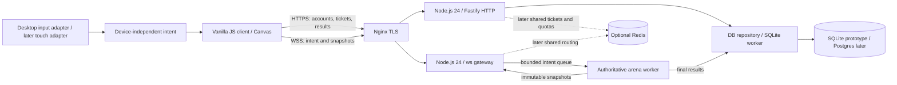

# Architecture

Status: Planned

## Components and boundaries

Status: Planned

All nodes below are planned. Start with one Node.js process for HTTP/WebSockets
and one simulation worker; retain the same message boundary if temporarily
running the simulation in-process during the first prototype.



| Planned path/component | Responsibility | Must not do |
| --- | --- | --- |
| `server/index.js` | Config, HTTP, upgrade routing, shutdown | Embed mechanics in routes |
| `server/http/routes.js` | [REST contracts](API.md), session/ticket checks | Accept client-written results |
| `server/net/gateway.js` | Authenticate upgrades/HELLO, decode, quotas, culling | Trust client positions or mass |
| `server/sim/arena.js` | Single owner of mutable arena state | Perform I/O in ticks |
| `server/sim/worker.js` | Worker message lifecycle and bounded queues | Share mutable entity objects |
| `server/db/worker.js` | Own SQLite connection; process persistence jobs | Block simulation for SQL |
| `server/db/repository.js` | Parameterized storage interface | Leak dialect details into mechanics |
| `client/src/input/` | Pointer, keyboard, later touch → normalized intent | Decide hit/eat outcomes |
| `client/src/net/` | Protocol, snapshot buffer, reconnect state machine | Persist auth/resume secrets |
| `client/src/render/` | Camera, Canvas, interpolation, HUD | Advance authoritative gameplay |
| `shared/constants.js`, `shared/protocol.js` | Pure constants, codecs, schema version | Import Node-only APIs in browser code |
| `db/migrations/` | Ordered immutable schema changes | Store live arena positions |

## Data flow and authority

Status: Planned

1. Browser loads static assets; optional HTTP login establishes a session.
2. HTTP issues a short-lived arena ticket. WSS `HELLO` consumes it.
3. Browser sends steering and edge-triggered action intent, not coordinates.
4. Gateway validates and queues at most the latest steering plus a bounded
   action list. The worker assigns actions to its next tick.
5. Arena applies [mechanics](GAME_DESIGN.md), resolves collisions, then exposes
   a consistent state version. Gateway serializes each player's visible subset.
6. Browser renders buffered snapshots; it never decides scores, collisions, or
   inventory. A locally predicted steering indicator is cosmetic only.
7. On death/disconnect expiry, the worker emits an idempotent result job.
   Persistence happens outside the tick; HTTP reads only committed results.

Client clocks, claimed FPS, mass, speed, viewport dimensions, and scores are not
authority. The camera center/visible world rectangle is server-derived. Culling
reduces information leakage, but is not a complete wallhack prevention system.

## Fixed-step simulation

Status: Planned

Use monotonic `performance.now()` with `dt = 1 / 30` seconds. A timer wakes the
loop; an accumulator, not timer accuracy, determines elapsed simulation steps.
Use a seeded arena PRNG and injected clock in tests.

```text
accumulate monotonic elapsed time
while accumulator >= dt and steps < MAX_CATCHUP_STEPS:
    drain validated intents; apply latest steering and bounded actions
    advance motion, boost, timers, decay; clamp to world bounds
    rebuild/update spatial hash
    resolve eats, virus bursts, sibling collisions/merges deterministically
    replenish food/viruses within spawn budgets
    increment tick; publish immutable state if send deadline reached
    accumulator -= dt
if still behind:
    record dropped simulation time; retain only accumulator modulo dt
schedule next wake-up; never busy-spin
```

`MAX_CATCHUP_STEPS = 3`; target tick compute p95 < 20 ms and p99 < 30 ms.
Dropping excess accumulated time intentionally slows an overloaded arena rather
than allowing unbounded catch-up. Alert and stop admissions; never increase `dt`
or let clients compensate by moving faster. Resolve competing eaters by greatest
mass, then smallest entity ID; process deferred removals once per tick.

Normal snapshots are 15 Hz (every two ticks); low-bandwidth snapshots are 5 Hz
(every six). Rendering is independently driven by `requestAnimationFrame`.
See [NETWORKING.md](NETWORKING.md) for rates and wire representation.

## Input abstraction and responsive rendering

Status: Planned

`client/src/input/controller.js` exposes:

```js
// Planned interface, not an implemented module.
readIntent() // { dx: number, dy: number, splitPressed: boolean, ejectPressed: boolean }
reset()      // release inputs on blur, visibility change, disconnect, adapter switch
```

`dx, dy` are world-axis normalized direction and magnitude in the unit disk.
Pointer offsets from the canvas center are divided by a 200 CSS-pixel steering
radius, then clamped; no world position is transmitted. Keyboard Space/W generate
single split/eject edges, excluding editable fields. Touch will use the same
interface. Resize and device pixel ratio affect rendering, not server movement or
the maximum visible world rectangle. See [MOBILE.md](MOBILE.md).

## Decisions (short ADRs)

Status: Planned

| ID | Proposed decision | Rationale / consequence |
| --- | --- | --- |
| ADR-001 | Node.js 24 ESM throughout | Shared JS mental model; built-in tests, no transpilation backend |
| ADR-002 | `ws` + native browser WebSocket | Simple upgrade control; benchmark before adopting native uWebSockets.js |
| ADR-003 | Fastify 5 | Schema validation/logging; Express remains an alternative, not a second server |
| ADR-004 | One owner per arena, fixed 30 Hz | Avoid races and client authority; horizontal scale adds arenas |
| ADR-005 | Worker boundaries, no shared mutable state | Isolate SQL/physics latency; bounded message-copy overhead |
| ADR-006 | Full culled binary snapshots v1 | Easy resync on mobile; deltas postponed until bandwidth measurements |
| ADR-007 | SQLite repository then Postgres | Prototype simplicity; SQLite synchronous work isolated in DB worker |
| ADR-008 | Opaque cookie sessions | Immediate revocation; no JWT refresh-token complexity |
| ADR-009 | Desktop first, input adapters now | Touch/network policies later without rewriting mechanics or rendering |

## Failure isolation

Status: Planned

Cap queues and reject admissions instead of growing memory. Worker crash ends its
arena; disconnect with service-restart code and do not invent results for lost
state. A process restart invalidates prototype tickets/resume tokens. DB outage
does not pause ticks: queue final results in a bounded outbox (1,000 entries),
retry with idempotency, stop new admissions if full, and alert. Prototype restart
may lose unpersisted results; durable result delivery is a phase-5 gate.
