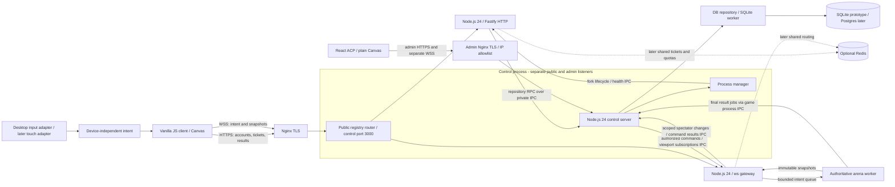

# Architecture

Status: Planned

## Components and boundaries

Status: Planned

All nodes below are planned. Start with one Node.js process for HTTP/WebSockets
and one simulation worker; retain the same message boundary if temporarily
running the simulation in-process during the first prototype.
The diagram shows the managed ACP target: DB work passes through control-owned
IPC. Before ACP, the standalone game owns the same DB worker directly.



| Planned path/component | Responsibility | Must not do |
| --- | --- | --- |
| `server/index.js` | Config, HTTP, upgrade routing, shutdown | Embed mechanics in routes |
| `server/http/routes.js` | [REST contracts](API.md), session/ticket checks | Accept client-written results |
| `server/net/gateway.js` | Authenticate upgrades/HELLO, decode, quotas, culling | Trust client positions or mass |
| `server/sim/arena.js` | Single owner of mutable arena state | Perform I/O in ticks |
| `server/sim/worker.js` | Worker message lifecycle and bounded queues | Share mutable entity objects |
| `server/db/worker.js` | Own SQLite connection; process persistence jobs | Block simulation for SQL |
| `server/db/repository.js` | Parameterized storage interface | Leak dialect details into mechanics |
| `client/src/input/` | Pointer, keyboard, later touch → normalized intent | Decide hit/eat outcomes |
| `client/src/net/` | Protocol, snapshot buffer, reconnect state machine | Persist auth/resume secrets |
| `client/src/render/` | Camera, Canvas, interpolation, HUD | Advance authoritative gameplay |
| `shared/constants.js`, `shared/protocol.js` | Pure constants, codecs, schema version | Import Node-only APIs in browser code |
| `db/migrations/` | Ordered immutable schema changes | Store live arena positions |
| `control/index.js`, `control/http/routes.js` | Admin API, auth, audit, static ACP | Accept player sessions as admin credentials |
| `control/router.js` | Separate public listener; registry-only player routing | Expose admin API through player-origin routes |
| `control/process-manager.js`, `control/ipc.js` | Fork lifecycle, health, validated IPC | Execute shell commands supplied by admin forms |
| `control/net/spectator.js` | Separate admin WS, viewport subscriptions/deltas | Reuse player opcodes or authorize in the browser |
| `admin/src/` | React pages/forms plus imperative Canvas wrapper | Render every entity through React |
| `shared/admin-protocol.js`, `shared/server-config.js` | Separate admin codecs; validated preset schema | Embed credentials or server-only dependencies |
| `shared/render/canvas.js` | Renderer shared by player and spectator adapters | Own input, authorization, or simulation |

## Data flow and authority

Status: Planned

1. Browser loads static assets; optional HTTP login establishes a session.
2. HTTP issues a short-lived arena ticket. WSS `HELLO` consumes it.
3. Browser sends steering and edge-triggered action intent, not coordinates.
4. Gateway validates and queues at most the latest steering plus a bounded
   action list. The worker assigns actions to its next tick.
5. Arena applies [mechanics](GAME_DESIGN.md), resolves collisions, then exposes
   a consistent state version. Gateway serializes each player's visible subset.
6. Browser renders buffered snapshots; it never decides scores, collisions, or
   inventory. A locally predicted steering indicator is cosmetic only.
7. On death/disconnect expiry, the worker emits an idempotent result job.
   Persistence happens outside the tick; HTTP reads only committed results.

Client clocks, claimed FPS, mass, speed, viewport dimensions, and scores are not
authority. The camera center/visible world rectangle is server-derived. Culling
reduces information leakage, but is not a complete wallhack prevention system.

## Fixed-step simulation

Status: Planned

Use monotonic `performance.now()` with `dt = 1 / tickHz` seconds (preset default
30 Hz; allowed rates in [ADMIN.md](ADMIN.md#create-server-variables)). A timer wakes the
loop; an accumulator, not timer accuracy, determines elapsed simulation steps.
Use a seeded arena PRNG and injected clock in tests.

```text
accumulate monotonic elapsed time
while accumulator >= dt and steps < MAX_CATCHUP_STEPS:
    drain validated intents; apply latest steering and bounded actions
    advance motion, boost, timers, decay; clamp to world bounds
    rebuild/update spatial hash
    resolve eats, virus bursts, sibling collisions/merges deterministically
    replenish food/viruses within spawn budgets
    increment tick; publish immutable state if send deadline reached
    accumulator -= dt
if still behind:
    record dropped simulation time; retain only accumulator modulo dt
schedule next wake-up; never busy-spin
```

`MAX_CATCHUP_STEPS = 3`; default-30-Hz target tick compute p95 < 20 ms and
p99 < 30 ms; alternate-rate gates are in DEPLOYMENT.md.
Dropping excess accumulated time intentionally slows an overloaded arena rather
than allowing unbounded catch-up. Alert and stop admissions; never increase `dt`
or let clients compensate by moving faster. Resolve competing eaters by greatest
mass, then smallest entity ID; process deferred removals once per tick.

Normal player snapshots are 15 Hz; low-bandwidth snapshots are 5 Hz. With allowed
15/30/60 Hz ticks, send every `tickHz / sendHz` ticks. Tick deadlines and load
gates must scale to the chosen rate, not assume 30 Hz globally.
Rendering is independently driven by `requestAnimationFrame`.
See [NETWORKING.md](NETWORKING.md) for rates and wire representation.

## Input abstraction and responsive rendering

Status: Planned

`client/src/input/controller.js` exposes:

```js
// Planned interface, not an implemented module.
readIntent() // { dx: number, dy: number, splitPressed: boolean, ejectPressed: boolean }
reset()      // release inputs on blur, visibility change, disconnect, adapter switch
```

`dx, dy` are world-axis normalized direction and magnitude in the unit disk.
Pointer offsets from the canvas center are divided by a 200 CSS-pixel steering
radius, then clamped; no world position is transmitted. Keyboard Space/W generate
single split/eject edges, excluding editable fields. Touch will use the same
interface. Resize and device pixel ratio affect rendering, not server movement or
the maximum visible world rectangle. See [MOBILE.md](MOBILE.md).

## Decisions (short ADRs)

Status: Planned

| ID | Proposed decision | Rationale / consequence |
| --- | --- | --- |
| ADR-001 | Node.js 24 ESM throughout | Shared JS mental model; built-in tests, no transpilation backend |
| ADR-002 | `ws` + native browser WebSocket | Simple upgrade control; benchmark before adopting native uWebSockets.js |
| ADR-003 | Fastify 5 | Schema validation/logging; Express remains an alternative, not a second server |
| ADR-004 | One owner per arena, fixed tick rate from preset (30 Hz default) | Avoid races and client authority; changes to tick rate require restart |
| ADR-005 | Worker boundaries, no shared mutable state | Isolate SQL/physics latency; bounded message-copy overhead |
| ADR-006 | Full culled player snapshots v1 | Easy player/mobile resync; separate admin feed uses viewport deltas/LOD |
| ADR-007 | SQLite repository then Postgres | Prototype simplicity; SQLite synchronous work isolated in DB worker |
| ADR-008 | Opaque cookie sessions | Immediate revocation; no JWT refresh-token complexity |
| ADR-009 | Desktop first, input adapters now | Touch/network policies later without rewriting mechanics or rendering |
| ADR-010 | React/Vite for ACP, imperative shared Canvas | Decided UI stack; React owns controls, not high-frequency entity rendering |
| ADR-011 | Separate control server and child game processes | Role/audit boundary and lifecycle isolation; workers remain an alternative, not hard CPU/RAM isolation |

## Control server and IPC

Status: Planned

The initial standalone prototype remains valid. When ACP is added, the control
server becomes the sole owner of the shared SQLite DB worker: game processes use
validated repository RPC over private parent/child IPC for accounts/results,
never open competing local databases. A game still owns public HTTP/WS and its
simulation worker. Spectator subscriptions are computed inside each game from
spatial indexes; only viewport changes/LOD records cross IPC, not periodic whole
world dumps. Postgres later can replace this repository boundary.

`control/process-manager.js` uses `child_process.fork()` with a fixed absolute
entry point, `shell: false` semantics, sanitized environment, IPC, and an immutable
validated config. No form field controls an executable, argv, bind address, or
filesystem path. A registry holds server ID, generation UUID, preset ID/version,
config revision, PID/private port, metrics timestamp, and state:
`starting → running → stopping → stopped`, or `failed`. Publish routing only after
READY. Restart waits for old process exit, allocates a new generation, and
invalidates old commands, subscriptions, tickets, and resume tokens.

| Planned IPC type | Direction | Required content |
| --- | --- | --- |
| `INIT` / `READY` | Control → game / game → control | serverId, generation, config, revision / actual bound port |
| `HEALTH` | Game → control every 1 s | generation, live/grace player count, tick p95, CPU interval, RSS |
| `COMMAND` / `RESULT` | Control → game / game → control | command UUID, generation, actor ID, allowlisted action/target/args / outcome, applied tick |
| `SUBSCRIBE` / `VIEWPORT` / `UNSUBSCRIBE` | Control → game | subscription ID, authorized viewport/zoom and view sequence |
| `FOLLOW` / `FOLLOW_POSITION` | Control ↔ game | subscription, generation, one selected player ID / bounded center or unavailable |
| `SPECTATOR_BATCH` | Game → control | subscription, generation, revision/base, scoped records |
| `DB_REQUEST` / `DB_RESULT` | Game ↔ control | bounded repository operation, request UUID, validated args/result |
| `STOP` | Control → game | command UUID, generation, graceful shutdown deadline |

Validate both directions, ≤1 MiB IPC payload, ≤100 queued control messages per
game; spectator batches use the smaller wire limits in NETWORKING.md.
`send()` success is transport enqueue, not action success. Mutations execute at
the next tick and acknowledge after application. Deduplicate command UUIDs for
the process lifetime; the control server stores durable command status in audit
rows and never blindly retries an uncertain mutation. HELLO/health fails after
10/5 seconds respectively; mark unhealthy/failed, withdraw routing and require
explicit restart (no invented automatic-restart policy). CPU/RSS come from the
game process and must include worker-thread scope as explained in DEPLOYMENT.md.

Persist an audit “pending” record before dispatch. Ban persistence and its audit
intent commit atomically before IPC kicks; failed delivery does not lift the ban.
Missing acknowledgment after 5 seconds is `unknown`, not success/failure; expose
that result to the ACP for operator reconciliation. Stop allows the existing
30-second flush deadline, then force-terminates the child after 40 seconds.
Live config updates use expected revision and only the ADMIN.md whitelist.

## Failure isolation

Status: Planned

Cap queues and reject admissions instead of growing memory. Worker crash ends its
arena; disconnect with service-restart code and do not invent results for lost
state. A process restart invalidates prototype tickets/resume tokens. DB outage
does not pause ticks: queue final results in a bounded outbox (1,000 entries),
retry with idempotency, stop new admissions if full, and alert. Prototype restart
may lose unpersisted results; durable result delivery is a phase-5 gate.
