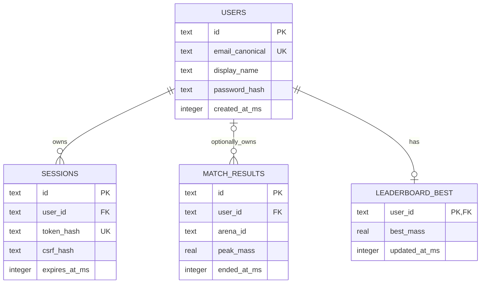

# Database and migrations

Status: Planned

## Persistence boundary

Status: Planned

SQLite file: `db/data/agar.sqlite`, owned by a dedicated DB worker using
`node:sqlite`. Proposed migration file: `db/migrations/001_initial.sql`.
Connection setup: `PRAGMA foreign_keys=ON; PRAGMA journal_mode=WAL;` and
`PRAGMA busy_timeout=5000;`. SQLite APIs are synchronous; never call them from
the simulation loop. Keep SQL parameterized and disable extension loading.
See runtime maturity notes in [DEVELOPMENT.md](DEVELOPMENT.md).

Store accounts, sessions, and life results, not per-tick positions. Tickets,
resume secrets, and guest identity exist only in prototype process memory.
Multiple gateways later need a shared atomic ticket/resume store or arena-local
routing, not independent copies of those maps.

## Entity relationships

Status: Planned

All tables and relationships shown are planned.



## Proposed initial schema

Status: Planned

UUIDs and wall-clock timestamps (integer Unix milliseconds) are generated in
Node.js. Milliseconds fit safely within JS integers for the intended lifetime.
Protocol simulation ticks are separate from wall-clock time. Validate Unicode
code-point lengths in application code as well as database constraints.

```sql
CREATE TABLE users (
  id TEXT PRIMARY KEY NOT NULL,
  email_canonical TEXT NOT NULL UNIQUE CHECK(length(email_canonical) <= 254),
  display_name TEXT NOT NULL CHECK(length(display_name) BETWEEN 1 AND 20),
  password_hash TEXT NOT NULL,
  created_at_ms INTEGER NOT NULL CHECK(created_at_ms >= 0)
) STRICT;

CREATE TABLE sessions (
  id TEXT PRIMARY KEY NOT NULL,
  user_id TEXT NOT NULL REFERENCES users(id) ON DELETE CASCADE,
  token_hash TEXT NOT NULL UNIQUE CHECK(length(token_hash) = 64),
  csrf_hash TEXT NOT NULL CHECK(length(csrf_hash) = 64),
  created_at_ms INTEGER NOT NULL,
  expires_at_ms INTEGER NOT NULL CHECK(expires_at_ms > created_at_ms)
) STRICT;

CREATE TABLE match_results (
  id TEXT PRIMARY KEY NOT NULL,
  user_id TEXT REFERENCES users(id) ON DELETE SET NULL,
  arena_id TEXT NOT NULL CHECK(length(arena_id) BETWEEN 1 AND 32),
  started_at_ms INTEGER NOT NULL,
  ended_at_ms INTEGER NOT NULL CHECK(ended_at_ms >= started_at_ms),
  duration_ticks INTEGER NOT NULL CHECK(duration_ticks >= 0),
  peak_mass REAL NOT NULL CHECK(peak_mass >= 0 AND peak_mass <= 320000),
  cells_eaten INTEGER NOT NULL CHECK(cells_eaten >= 0),
  end_reason TEXT NOT NULL
    CHECK(end_reason IN ('eaten', 'disconnect_expired', 'left'))
) STRICT;

CREATE TABLE leaderboard_best (
  user_id TEXT PRIMARY KEY NOT NULL REFERENCES users(id) ON DELETE CASCADE,
  best_mass REAL NOT NULL CHECK(best_mass >= 0 AND best_mass <= 320000),
  updated_at_ms INTEGER NOT NULL
) STRICT;

CREATE INDEX sessions_user ON sessions(user_id);
CREATE INDEX sessions_expiry ON sessions(expires_at_ms);
CREATE INDEX results_user_recent
  ON match_results(user_id, ended_at_ms DESC, id DESC);
CREATE INDEX results_retention ON match_results(ended_at_ms);
CREATE INDEX leaderboard_rank ON leaderboard_best(best_mass DESC, user_id ASC);

CREATE TABLE IF NOT EXISTS schema_migrations (
  version INTEGER PRIMARY KEY,
  checksum TEXT NOT NULL,
  applied_at_ms INTEGER NOT NULL
) STRICT;
```

The 320,000 mass bound is `MAX_CELLS * MAX_CELL_MASS`; migrate this check if tuning
raises that limit. No unique display-name constraint: use user IDs as identity.
Index-backed email/session lookups are unique; session expiry and result retention
cleanup run in small batches outside ticks.

## Result transaction and idempotency

Status: Planned

Generate the result UUID once when the life starts. At finalization, the worker
emits the same ID on every retry. In one transaction:

1. Insert result with `ON CONFLICT(id) DO NOTHING`.
2. Only if inserted and `user_id` is non-null, upsert `leaderboard_best` using
   `max(existing best_mass, incoming peak_mass)`; update timestamp only on improvement.
3. Commit, then acknowledge the outbox job.

Use this indexed leaderboard read, with bound parameters for cursor values:

```sql
SELECT u.id AS user_id, u.display_name, b.best_mass
FROM leaderboard_best b JOIN users u ON u.id = b.user_id
WHERE b.best_mass < :mass
   OR (b.best_mass = :mass AND b.user_id > :user_id)
ORDER BY b.best_mass DESC, b.user_id ASC
LIMIT :limit_plus_one;
```

Omit the WHERE clause for the first page. Fetch limit+1 to derive `nextCursor`.
Encode the unrounded stored mass in the cursor, not the rounded display value.
Match history uses the analogous `(ended_at_ms, id)` descending predicate.

## Migrations, backup, and Postgres transition

Status: Planned

Planned `server/db/migrate.js` creates the ledger if absent, acquires a single
deployment migration lock, verifies applied checksums, and runs unapplied numbered
SQL files in transactions. The initial SQL uses `CREATE TABLE IF NOT EXISTS` only
for the bootstrap migration ledger; its occurrence above describes the final
schema. The runner's ledger bootstrap is infrastructure outside migration
tracking; migration 001 (including its harmless ledger existence check) receives
one checksum/ledger row, not a separate ledger-table migration. Never silently
edit an applied migration.

Run `npm run db:migrate` as a separate pre-start release task, not in every
replica. Failed migrations abort readiness; back up before destructive changes.
Use SQLite's online backup API or a quiesced/checkpointed backup procedure;
copying just the live `.sqlite` file can omit WAL transactions. Test restores.
Retain daily encrypted backups for seven days initially, with credentials/access
separate from the app; retention needs owner approval.

Later Postgres uses `pg`, one bounded pool per process, UUID columns, BIGINT Unix
milliseconds, DOUBLE PRECISION mass, and explicit CHECK constraints. Translate
SQLite STRICT/PRAGMAs rather than running SQLite SQL unchanged. Convert BIGINT
driver strings to validated safe integers at the repository boundary. Use
`GREATEST` rather than SQLite scalar `max` in upserts. Keep HTTP JSON unchanged.
Run adapter contract tests against both engines, export/import during a planned
maintenance window, reconcile row counts/best scores, then switch `DATABASE_URL`.
Do not use SQLite on shared network storage or permit separate replicas to write
independent local files as if they were one database.

Initial retention proposal: delete expired sessions hourly; prune guest results
after seven days and account match detail after 90 days. Preserve leaderboard
summary until account deletion. Account deletion is not an initial API endpoint;
an operator procedure must revoke sessions, delete the user/summary, and unlink
retained results before accounts launch. Never back up raw session/ticket secrets.
