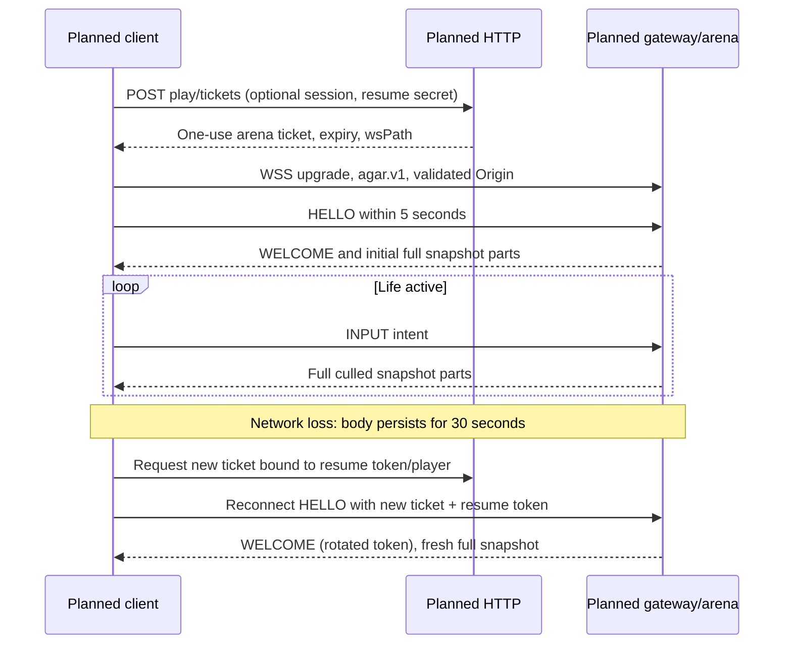

# Networking and binary protocol v1

Status: Planned

## Transport and encoding

Status: Planned

Use native browser WebSocket with `binaryType = "arraybuffer"` and Node.js `ws`.
Production is WSS only, same-origin, path `/ws/<arenaId>`, subprotocol `agar.v1`.
Disable `permessage-deflate` initially. One binary WebSocket message contains
exactly one application message; TCP/WebSocket frame boundaries are not an
application fragmentation scheme.

All integers and IEEE-754 floats are **little-endian**, using `DataView` in shared
code. Offsets below are bytes, relative to the named header/payload/record.
Reject non-finite floats, wrong direction/type, nonzero reserved fields, trailing
bytes, truncated arrays, invalid UTF-8, and unknown version. IDs are unsigned u32;
0 means no owner/no input acknowledgment. Entity/player IDs are arena-local,
allocated monotonically without reuse during an arena lifetime; restart before
exhaustion. UUID strings used by HTTP/SQL are not wire entity IDs.

### Common header — every player message (8 bytes)

Status: Planned

| Offset | Field | Type | Rule |
| --- | --- | --- | --- |
| 0 | type | u8 | Opcode below |
| 1 | version | u8 | Exactly 1 |
| 2 | payloadBytes | u16 | Exact bytes after header |
| 4 | sequence | u32 | Starts at 1, increments per direction per connection |

Use modular sequence comparisons: `a` is newer than `b` iff unsigned
`a-b` is in `(0, 2^31)`. Skip 0 on wrap. Drop duplicate/stale inputs without
repeating actions. `ackInputSequence` acknowledges the last INPUT applied, not the
last arbitrary message. Tick is a u32 simulation step counter; compare modulo
2^32. A time value named `*Ms` is u32 monotonic milliseconds modulo 2^32;
measure differences only over intervals below 2^31 ms. Never compare client and
server clock origins directly.

Define these transport bounds in planned `shared/protocol.js` (sizes include the
8-byte header). Encoders must assert them before sending; decoders must check them
before allocating. Add boundary fixtures for each in `shared/protocol.test.js`.
`ws.maxPayload` enforces the client limit on the server; the browser connection
handler enforces the server limit on receipt.

| Planned protocol constant | Value |
| --- | --- |
| `MAX_CLIENT_MESSAGE_BYTES` | 256 |
| `MAX_SERVER_MESSAGE_BYTES` | 61,440 |
| `MAX_SNAPSHOT_PART_ENTITIES` | 2,400 |
| `MAX_SNAPSHOT_ENTITIES` | 6,000 |
| `MAX_SNAPSHOT_PARTS` | 3 |

| Opcode | Direction | Planned message | Payload size |
| --- | --- | --- | --- |
| `0x01` | C → S | HELLO | `5 + ticketBytes + resumeBytes` |
| `0x02` | C → S | INPUT | 8 |
| `0x03` | C → S | PING | 4 |
| `0x04` | C → S | SETTINGS | 3 |
| `0x81` | S → C | WELCOME | 60 |
| `0x82` | S → C | SNAPSHOT_PART | `28 + 24 * entityCount` |
| `0x83` | S → C | PONG | 8 |
| `0x84` | S → C | LIFE_ENDED | 9 |
| `0xff` | S → C | ERROR | `3 + textBytes` |

### HELLO payload

Status: Planned

| Offset | Field | Type | Rule |
| --- | --- | --- | --- |
| 0 | mode | u8 | 0 normal, 1 low bandwidth |
| 1 | aspectQ | u16 | Aspect × 1000; clamp to 500..1778 |
| 3 | ticketBytes | u8 | Exactly 43 |
| 4 | ticket | bytes[ticketBytes] | Base64url ASCII, 256-bit one-use ticket |
| 4 + ticketBytes | resumeBytes | u8 | 0 on fresh join, 43 on reconnect |
| 5 + ticketBytes | resumeToken | bytes[resumeBytes] | In-memory bearer secret |

Ticket comes from [POST /api/v1/play/tickets](API.md). Bind it to arena and
session ID (or anonymous guest identity) and, for reconnect, the specified player
and hash of resume token. Never put secrets in URLs, subprotocols, or logs.

### INPUT payload

Status: Planned

| Offset | Field | Type | Rule |
| --- | --- | --- | --- |
| 0 | dx | i16 | -32767..32767, divide by 32767 |
| 2 | dy | i16 | Same; reject -32768 |
| 4 | actions | u8 bitset | Bit 0 split, bit 1 eject; other bits 0 |
| 5 | reserved | u8 | 0 |
| 6 | reserved | u16 | 0 |

Clamp decoded vector length to 1. Action bits are discrete press events, not held
state; never retransmit an action across reconnect. Multiple INPUTs in a tick
replace steering but queue at most one split and one eject attempt per player,
with split processed first. Server cooldowns still apply.

### SETTINGS, PING, PONG payloads

Status: Planned

| Message | Offset | Field | Type | Rule |
| --- | --- | --- | --- | --- |
| SETTINGS | 0 | mode | u8 | 0 or 1; server may force 1 |
| SETTINGS | 1 | aspectQ | u16 | Same clamp as HELLO |
| PING | 0 | clientTimeMs | u32 | Echo token / RTT sample |
| PONG | 0 | clientTimeMs | u32 | Exact echo |
| PONG | 4 | serverTimeMs | u32 | Server monotonic sample |

### WELCOME payload

Status: Planned

| Offset | Field | Type | Rule |
| --- | --- | --- | --- |
| 0 | playerId | u32 | Owned cells refer to this |
| 4 | serverTick | u32 | Current simulation tick |
| 8 | tickHz | u8 | Validated preset value: 15, 30, or 60; default 30 |
| 9 | sendHz | u8 | 15 or 5 |
| 10 | mode | u8 | Effective mode, also confirms settings changes |
| 11 | resumed | u8 | 0 or 1 |
| 12 | worldSize | f32 | Validated preset world size; default 12000 |
| 16 | resumeTokenBytes | u8 | Exactly 43 |
| 17 | resumeToken | bytes[43] | New rotated secret on each WELCOME |

WELCOME follows HELLO and each accepted SETTINGS; SETTINGS rotation invalidates
the previous resume token. No new player is created on SETTINGS.

### SNAPSHOT_PART payload and entity record

Status: Planned

Every player snapshot is a **full replacement of the visible set**, not a delta.

| Offset | Field | Type | Rule |
| --- | --- | --- | --- |
| 0 | serverTick | u32 | Same across parts |
| 4 | ackInputSequence | u32 | 0 until first applied input |
| 8 | cameraX | f32 | Server-authorized center |
| 12 | cameraY | f32 | Server-authorized center |
| 16 | verticalSpan | f32 | Authorized world span |
| 20 | partIndex | u16 | Zero-based |
| 22 | partCount | u16 | 1..3 |
| 24 | entityCount | u16 | 0..2400 in this part |
| 26 | reserved | u16 | 0 |
| 28 | entities | record[entityCount] | Layout below |

| Record offset | Field | Type | Rule |
| --- | --- | --- | --- |
| 0 | entityId | u32 | Unique nonzero |
| 4 | ownerId | u32 | Player ID for cells; otherwise 0 |
| 8 | x | f32 | Finite world coordinate |
| 12 | y | f32 | Finite world coordinate |
| 16 | mass | f32 | Positive; radius derived from gameplay formula |
| 20 | red | u8 | Server-selected color |
| 21 | green | u8 | Server-selected color |
| 22 | blue | u8 | Server-selected color |
| 23 | kind | u8 | 1 player cell, 2 food, 3 ejected, 4 virus |

At 2,400 records, a message is `8 + 28 + 2400*24 = 57,636` bytes,
below the 61,440-byte server-message cap. At most 6,000 entities per visible set;
current global gameplay caps fit below that. Do not silently truncate a visible
threat. If future arena limits exceed the cap, revise the protocol or view policy.

Assemble by tick; header sequences differ per part. Apply only when all parts
arrive with consistent metadata, unique indices and entity IDs, and ≤6,000 total
records. Keep at most two incomplete sets for ≤1 second; discard older sets.
No entity state changes until complete. Empty view uses one empty part. An entity
absent from the next full set is removed from rendering; absence does not prove
death. The local death notification is LIFE_ENDED.

### LIFE_ENDED and ERROR payloads

Status: Planned

| Message | Offset | Field | Type | Rule |
| --- | --- | --- | --- | --- |
| LIFE_ENDED | 0 | peakMass | f32 | Final authoritative score |
| LIFE_ENDED | 4 | durationTicks | u32 | Life duration |
| LIFE_ENDED | 8 | reason | u8 | 1 eaten, 2 disconnect expired, 3 left |
| ERROR | 0 | code | u16 | Mapping below |
| ERROR | 2 | textBytes | u8 | 0..120 |
| ERROR | 3 | text | bytes[textBytes] | UTF-8 diagnostic, no secrets |

| ERROR code | Name | WebSocket close behavior |
| --- | --- | --- |
| 1 | `BAD_MESSAGE` | Send ERROR, then 1002 |
| 2 | `AUTH_REQUIRED` | Send ERROR, then 1008 |
| 3 | `ARENA_BUSY` | Send ERROR, then 1013; retry with a new ticket |
| 4 | `RESUME_EXPIRED` | Send ERROR, then 1008; show respawn, do not auto-resume |
| 5 | `RATE_LIMITED` | Sample ERROR at most once/s; drop excess INPUT; 1008 after 5 seconds of persistent excess |
| 6 | `VERSION_UNSUPPORTED` | Send ERROR, then 1002 |

Oversize messages close 1009 without requiring an application ERROR. Use 1012 for
service restart and 1013 for other temporary overload. Unexpected faults use 1011
without stack traces. Do not reuse reserved 1006 as a transmitted close code.

## Lifecycle, reconnect, and visibility

Status: Planned

Unauthenticated upgrades reserve no simulation slot and have tight connection
caps. Failed HELLO consumes/invalidates a ticket atomically if it was presented;
retry obtains another. A reconnect token identifies a still-live body, not
invulnerability. On disconnect set steering to zero next tick, discard actions,
and keep cells edible for 30 seconds. At expiry remove remaining cells and record
one result. If eaten meanwhile, token becomes invalid; return `RESUME_EXPIRED`
and show respawn UI. Successful resume replaces/closes any old socket atomically,
retains player ID, resets transport sequences, and starts a fresh snapshot buffer.
Logging out revokes associated tickets/resume access and disconnects that session.

Retry delays: 0.5, 1, 2, 4, then 8 seconds, each with ±20% jitter. Stop at
30 seconds or after policy/auth errors; resume only on explicit user action if
page was backgrounded. Show “reconnecting,” never simulate an offline outcome.
Anonymous identity and resume secret stay in memory; reload starts a new life.

## Culling, interpolation, and budgets

Status: Planned

Server determines the camera from owned mass; client supplies only bounded
aspect. Include circles intersecting the camera rectangle expanded by 200 WU
(covers smoothing) and all owned cells. Never let a client arbitrary-center its
view. Remove departed entities on full-set replacement.

Render at estimated server time minus 100 ms normal / 250 ms low-bandwidth.
Estimate time from WELCOME, snapshot ticks, and PING RTT; smooth corrections.
Interpolate matching IDs between complete snapshots. New entities appear at their
first sample; vanished entities are not extrapolated into gameplay. Extrapolate
position at most 100 ms from the last two samples, then freeze and show network
status. Do not extrapolate eating or merges. No client rewind/hit claims.

| Planned limit | Normal | Low bandwidth |
| --- | --- | --- |
| Simulation | Preset 15/30/60 Hz (default 30) | Same arena rate (unchanged fairness) |
| Snapshot send | 15 Hz | 5 Hz |
| Input sampling/send | ≤30 Hz | ≤15 Hz |
| Vertical camera cap | 3000 WU | 1800 WU |
| Average outbound target per player | 128 KiB/s | 32 KiB/s |
| Interpolation delay | 100 ms | 250 ms |

Full snapshots prioritize correctness over minimal traffic; at 200 visible
entities, normal traffic is about 72,540 bytes/s before transport overhead.
Targets are not guaranteed at high density. Measure and introduce versioned
deltas only if needed; never omit nearby enemies to meet a budget.
Mode changes get a WELCOME; arena/gameplay does not reset.

Gateway accepts at most 40 INPUT/s (burst 10), 2 PING/s (burst 2), and
1 SETTINGS/s (burst 2), with a 50-message/s overall cap (burst 15). Client message
cap is 256 bytes including header (`ws.maxPayload = 256`); no text accepted.
Use token buckets; drop excess INPUT, close 1008 if excess persists for 5 seconds.
Control/error messages have a server cap of 256 bytes, except WELCOME/snapshots
which still obey their layouts. Maintain `bufferedAmount` soft limit 256 KiB:
skip entire snapshot sets, do not queue stale frames; force low-bandwidth mode.
Above 1 MiB or soft-limit persistence for 10 seconds, close 1013. Keep one pending
snapshot per peer. Ping WebSocket control frames every 15 seconds, terminate if no
pong for 30 seconds; browser automatically answers control pings.
## Player admin notices

Status: Planned

Keep admin commands off player connections. To deliver the requested one-way
admin message/mute state, add server-only opcode `0x85 ADMIN_NOTICE` to the
existing `agar.v1` player contract before implementation. It uses the player
8-byte header, never the admin header. This planned extension needs codec/client
tests; a deployed incompatible protocol would require a version change.

| Payload offset | Field | Type | Rule |
| --- | --- | --- | --- |
| 0 | kind | u8 | 1 message, 2 mute enabled, 3 mute disabled, 4 live rename |
| 1 | textBytes | u16 | 0..512 UTF-8 bytes |
| 3 | text | bytes[textBytes] | Message or new live name; empty for mute |

Maximum notice is 523 bytes including header, an explicit exception to the
256-byte server control-message cap (still below `MAX_SERVER_MESSAGE_BYTES`).
Messages: ≤200 Unicode code points/512 UTF-8 bytes; live names use API display-name
validation. Display as safe text/Canvas text, no markup. No reply opcode or player
chat is added. Reject client-sent `0x85`; moderation intent only originates from
the authenticated control API/WS and validated IPC.

## Admin spectator protocol v1

Status: Planned

Separate path `/admin/ws`, subprotocol `agar.admin.v1`, handled by the control
server on the admin origin. Never accept player credentials or player opcodes.
Require admin session, IP allowlist, exact Origin, and a single-use 30-second
ticket from `POST /admin/api/v1/auth/ws-tickets` (CSRF-protected). First binary
message is `AUTH` containing exactly 43 ASCII base64url ticket bytes; authenticate
within 5 seconds or close 1008. The ticket is session-bound, not in the URL.
After AUTH send VIEWPORT to subscribe to one server generation. Reconnect gets a
new ticket and a new initial snapshot, not a replay of uncertain commands.
The first SNAPSHOT confirms successful authentication/subscription; AUTH failure
closes the socket. Serialize AUTH validation before processing the first VIEWPORT
(at most one bounded pending viewport); accept no commands while authenticating.

Use little-endian fields and finite floats, strict lengths and modular nonzero
sequences as in the player codec, but a **different 16-byte header** and codec
`shared/admin-protocol.js`. Reject unused/reserved bits, invalid UUID bytes,
duplicate batch parts, and unrecognized actions.

| Header offset | Field | Type | Rule |
| --- | --- | --- | --- |
| 0 | type | u8 | Opcodes below |
| 1 | version | u8 | 1 |
| 2 | flags | u8 | 0 |
| 3 | reserved | u8 | 0 |
| 4 | payloadBytes | u32 | Exact bytes after 16-byte header |
| 8 | sequence | u32 | Transport sequence, each direction, starting at 1 |
| 12 | requestId | u32 | Echo for requests/results; 0 for unsolicited data |

| Opcode | Direction | Planned message | Payload bytes |
| --- | --- | --- | --- |
| `0x01` | ACP → control | AUTH | 43 |
| `0x02` | ACP → control | VIEWPORT | `42 + serverIdBytes` |
| `0x03` | ACP → control | COMMAND | `42 + serverIdBytes + argsBytes` |
| `0x04` | ACP → control | FOLLOW | 4 |
| `0x81` | Control → ACP | SNAPSHOT | `40 + 32 * recordCount` |
| `0x82` | Control → ACP | DELTA | `40 + 36 * recordCount` |
| `0x83` | Control → ACP | COMMAND_RESULT | `21 + resultBytes` |
| `0x84` | Control → ACP | FOLLOW_POSITION | 33 |
| `0xff` | Control → ACP | ERROR | `3 + textBytes`, same error payload shape as player ERROR |

UUIDs are 16 raw bytes in RFC canonical hex order (not GUID mixed-endian);
server IDs are ASCII letters/digits/hyphens, 1..32 bytes. JSON byte strings below
are fatal-decoded UTF-8, objects only, validated against the same REST schemas.

### Viewport and batch formats

Status: Planned

VIEWPORT coordinates are top-left world position and world spans; zoom is CSS
pixels per WU, independent of DPR. Whole-world views are allowed only here.

| VIEWPORT offset | Field | Type | Rule |
| --- | --- | --- | --- |
| 0 | serverIdBytes | u8 | 1..32 |
| 1 | serverId | bytes[n] | Manager-assigned registry ID |
| 1+n | generation | bytes[16] | Must match running server |
| 17+n | viewSequence | u32 | Newer viewport sequence, starting at 1 |
| 21+n | x | f32 | 0..worldSize |
| 25+n | y | f32 | 0..worldSize |
| 29+n | width | f32 | 1..worldSize |
| 33+n | height | f32 | 1..worldSize |
| 37+n | zoom | f32 | 0.005..2 CSS px/WU |
| 41+n | reset | u8 | 1 first subscribe/recovery, otherwise 0 |

Clamp rectangle to world bounds; reject empty intersection. ACP derives zoom and
rectangle from Canvas CSS size; server chooses LOD, not a requested detail enum.
Require `width * zoom` and `height * zoom` ≤4096 CSS px to bound fabricated
high-detail world views; viewport can cover the whole world at an appropriate zoom.
At most 10 viewport updates/s, coalescing pending movement to the newest request.
The subscription retains the last committed visible set across view changes.

SNAPSHOT and DELTA share the following 40-byte payload prefix:

| Offset | Field | Type | Rule |
| --- | --- | --- | --- |
| 0 | viewSequence | u32 | View request this batch commits |
| 4 | baseRevision | u32 | 0 for SNAPSHOT; previous committed revision for DELTA |
| 8 | revision | u32 | Nonzero, monotonic per subscription |
| 12 | serverTick | u32 | Sampling tick |
| 16 | partIndex | u16 | Zero-based |
| 18 | partCount | u16 | 1..8 |
| 20 | recordCount | u16 | ≤1800 snapshot or ≤1600 delta records/part |
| 22 | lod | u8 | 0 detailed, 1 medium, 2 overview |
| 23 | reserved | u8 | 0 |
| 24 | generation | bytes[16] | Must match current subscribed server generation |

Each snapshot record is 32 bytes:

| Offset | Field | Type | Rule |
| --- | --- | --- | --- |
| 0 | renderId | u32 | Stable while tracked within subscription/LOD; nonzero |
| 4 | playerId | u32 | Actual player ID for cells; 0 for nonplayers |
| 8 | x | f32 | Center WU |
| 12 | y | f32 | Center WU |
| 16 | mass | f32 | Actual mass, or aggregate total |
| 20 | radius | f32 | Derived cell radius or aggregate visual extent |
| 24 | red | u8 | Server-selected color |
| 25 | green | u8 | Server-selected color |
| 26 | blue | u8 | Server-selected color |
| 27 | kind | u8 | Player kinds 1..4; 5 aggregated food |
| 28 | itemCount | u16 | 1 actual entity; aggregate count 1..3000 |
| 30 | flags | u16 | Bit 0 simplified drawing; other bits zero |

Admin render IDs are a separate namespace mapped from entity IDs and stable food
tile keys; never pass them as player targets. No arbitrary mass cap/radius
formula applies to aggregate graphics. No account/email/name strings are included.
Release mappings after committed removal; reentry may allocate a new ID. Never
reuse an ID in a subscription; reset subscription before u32 exhaustion. Keep
mapping storage bounded by tracked/pending records, not all historical entities.

Each DELTA record is a 4-byte operation prefix plus a **complete 32-byte record**:

| Offset | Field | Type | Rule |
| --- | --- | --- | --- |
| 0 | op | u8 | 1 spawn, 2 move, 3 resize, 4 remove, 5 combined/metadata update |
| 1 | removeReason | u8 | 0 unless remove; 1 disappeared, 2 left region, 3 LOD replaced |
| 2 | reserved | u16 | 0 |
| 4 | entity | bytes[32] | Complete replacement; remove has only renderId, remaining bytes zero |

Spawn is also used for entities entering the region. Move changes only center,
resize changes mass/radius/count, op 5 covers simultaneous changes/color/flags.
Remove means remove from this view, not necessarily death. Operations in a batch
have unique render IDs; validate move/resize/update against known IDs and spawn
against absent IDs. A batch is the difference between two sampled visible sets,
not a replay of every intermediate simulation event.

Initial subscription sends SNAPSHOT. Subsequent samples and viewport changes send
DELTA: remove departed records, spawn newly visible records, update changed
overlap records, retain unchanged overlap. An LOD transition removes/replaces
food representations using stable keys, retaining compatible player records.
View changes do **not** reset revision or clear the entire map. No separate full
world feed runs underneath this regional protocol.

Apply multipart batches atomically after all parts arrive. Require contiguous
`baseRevision`, matching metadata, ≤6000 resulting records and ≤12000 delta
operations/batch. Retain at most two incomplete batches for ≤1 s.
During fast pan, finish revision commits in order even for an older viewSequence;
do not discard an intermediate delta on which newer revisions depend. Mark the
display “resyncing” until the latest requested viewSequence commits.
On gap/timeout/invalid base, request reset=1, discard pending batches, and wait for
a SNAPSHOT; a full **regional** snapshot is allowed for initial load and recovery.
Changing server/generation always creates a new subscription/baseline.
Discard old-generation batches, even if their revisions/view sequences match.
After reset=1, ignore old deltas until a snapshot for that reset viewSequence (or
a newer coalesced request) commits; reset does not replay pending commands.

### LOD, bandwidth, and flow control

Status: Planned

| LOD / zoom | Planned representation | Send/interpolation |
| --- | --- | --- |
| 0: zoom ≥0.05 px/WU | Exact entities including food; circles | 10 Hz / 100 ms |
| 1: 0.01≤zoom<0.05 | Food aggregated in worldSize/64 tiles; cells <2 CSS px simplified | 10 Hz / 100 ms |
| 2: zoom<0.01 | Food aggregated in worldSize/32 tiles; no cell labels, tiny cells drawn as dots | 5 Hz / 200 ms |

Aggregate only visible food, using tile center, sum mass, count, half-tile-diagonal
visual radius; include tiles intersecting viewport. Player IDs remain individually
selectable at every LOD; crowded overview clicks should offer a candidate list or
zoom-in. Do not aggregate players into actionable anonymous blobs. Interpolate
matching IDs, never infer kills. FOLLOW is a nonmutating subscription message
with one u32 playerId (0 stops following), limited to 2/s. Control resolves it
only in the subscribed generation, sends typed `FOLLOW` IPC to the game, and
receives at most one selected-player center sample per feed interval even if that
player leaves the viewport. ACP still computes/sends its bounded viewport.

| FOLLOW_POSITION offset | Field | Type | Rule |
| --- | --- | --- | --- |
| 0 | generation | bytes[16] | Current subscription generation |
| 16 | playerId | u32 | Selected actual player ID |
| 20 | available | u8 | 0 disappeared, 1 live |
| 21 | x | f32 | Mass-weighted center WU; 0 if unavailable |
| 25 | y | f32 | Same |
| 29 | serverTick | u32 | Sampling tick |

Unavailable clears follow; stale-generation samples are ignored. This is bounded
selected-target metadata, not an uncropped entity feed or gameplay command.

Admin caps in `shared/admin-protocol.js`: inbound 4096 bytes, outbound 61440 bytes,
6000 records/subscription, 8 parts/batch, one subscription/socket, two sockets/admin.
Maximum snapshot part: `16 + 40 + 1800*32 = 57,656` bytes. Maximum delta part:
`16 + 40 + 1600*36 = 57,656` bytes. Full 6000-record snapshot ≈188 KiB.
Example 200 changed records at 10 Hz ≈72,560 bytes/s (before WS/TLS);
20 changes at 5 Hz ≈3,880 bytes/s. A 2000-food/200-player whole-world view at
overview costs at most about 39 KiB initially before other entities, with food
tile occupancy/density controlling the actual count. Targets: ≤128 KiB/s active
detail, ≤32 KiB/s settled overview; these are workload targets, not guarantees.

Unlike full player snapshots, **never skip a delta after advancing its baseline**.
At control/socket soft buffer limit 256 KiB, pause emission, retain last queued
revision baseline, coalesce next sample against that baseline, and reduce 10 to
5 Hz. Above 1 MiB or 10 s stalled, close 1013; reconnect resnapshots.
If IPC batches cannot be retained contiguously, explicitly reset region baseline.
Use control ping/pong 15/30 s and admin-session/role checks every 60 s and before
each command. Logout/role revocation immediately closes associated subscriptions.

### Command and result formats

Status: Planned

Only selected-player mutations use COMMAND; lifecycle, presets, bans, and live
config also have REST endpoints. Both transports share authorization, validation,
audit, idempotency, and the same private IPC dispatcher. Follow changes local
camera/subscription metadata only, not game state or audit command status.

| COMMAND offset | Field | Type | Rule |
| --- | --- | --- | --- |
| 0 | serverIdBytes | u8 | 1..32 |
| 1 | serverId | bytes[n] | Registry ID |
| 1+n | generation | bytes[16] | Prevent stale-process targeting |
| 17+n | commandId | bytes[16] | Client-generated UUID, durable idempotency key |
| 33+n | playerId | u32 | Live player, not render ID |
| 37+n | action | u8 | 1 kick, 2 ban, 3 mute, 4 rename, 5 kill, 6 set_mass, 7 message |
| 38+n | argsBytes | u32 | ≤2048 |
| 42+n | args | bytes[argsBytes] | REST action JSON: reason plus action-specific fields |

| COMMAND_RESULT offset | Field | Type | Rule |
| --- | --- | --- | --- |
| 0 | commandId | bytes[16] | Same UUID |
| 16 | status | u8 | 0 pending, 1 applied, 2 rejected, 3 unknown |
| 17 | resultBytes | u32 | ≤2048 |
| 21 | result | bytes[resultBytes] | Validated JSON, e.g. `{"appliedTick":120,"code":null}` |

Echo header requestId in replies; a final result may arrive after pending.
Mutation args always include a nonempty reason; the API section owns exact action
fields and status polling. Retrying the same command ID with differing args is
`COMMAND_CONFLICT`; uncertain outcomes are reconciled, not automatically rerun.
Admin ERROR codes: 1 BAD_MESSAGE (1002), 2 AUTH_REQUIRED (1008),
3 FORBIDDEN (1008), 4 STALE_GENERATION (keep socket; select current server),
5 RATE_LIMITED (keep socket, close 1008 on sustained abuse), 6 RESYNC_REQUIRED
(request regional snapshot). Oversize →1009, overload →1013, restart →1012.
