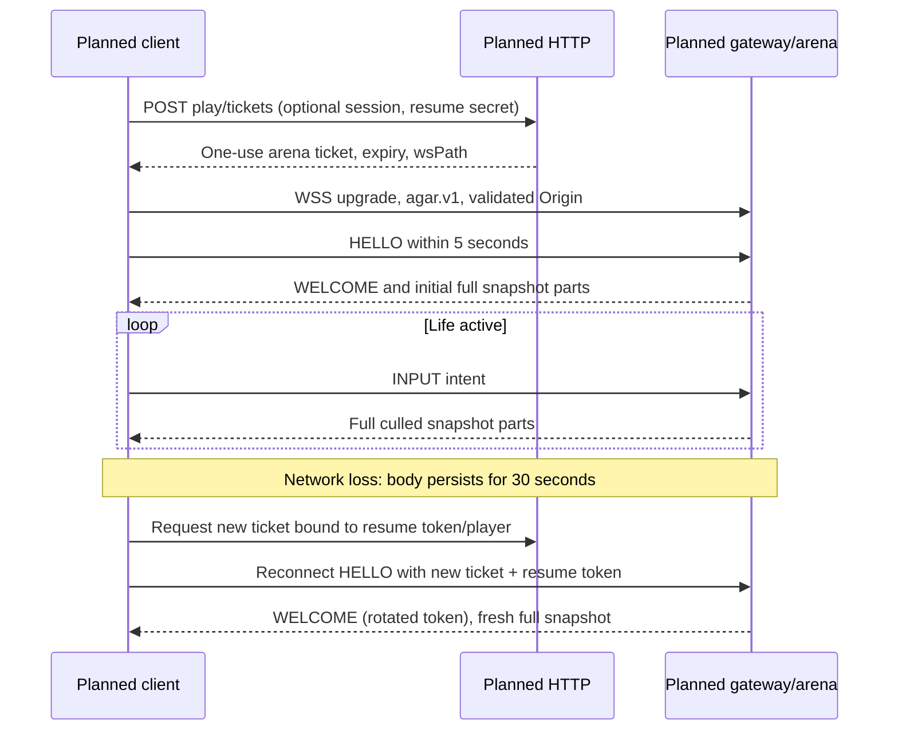

# Networking and binary protocol v1

Status: Planned

## Transport and encoding

Status: Planned

Use native browser WebSocket with `binaryType = "arraybuffer"` and Node.js `ws`.
Production is WSS only, same-origin, path `/ws/<arenaId>`, subprotocol `agar.v1`.
Disable `permessage-deflate` initially. One binary WebSocket message contains
exactly one application message; TCP/WebSocket frame boundaries are not an
application fragmentation scheme.

All integers and IEEE-754 floats are **little-endian**, using `DataView` in shared
code. Offsets below are bytes, relative to the named header/payload/record.
Reject non-finite floats, wrong direction/type, nonzero reserved fields, trailing
bytes, truncated arrays, invalid UTF-8, and unknown version. IDs are unsigned u32;
0 means no owner/no input acknowledgment. Entity/player IDs are arena-local,
allocated monotonically without reuse during an arena lifetime; restart before
exhaustion. UUID strings used by HTTP/SQL are not wire entity IDs.

### Common header — every message (8 bytes)

Status: Planned

| Offset | Field | Type | Rule |
| --- | --- | --- | --- |
| 0 | type | u8 | Opcode below |
| 1 | version | u8 | Exactly 1 |
| 2 | payloadBytes | u16 | Exact bytes after header |
| 4 | sequence | u32 | Starts at 1, increments per direction per connection |

Use modular sequence comparisons: `a` is newer than `b` iff unsigned
`a-b` is in `(0, 2^31)`. Skip 0 on wrap. Drop duplicate/stale inputs without
repeating actions. `ackInputSequence` acknowledges the last INPUT applied, not the
last arbitrary message. Tick is a u32 simulation step counter; compare modulo
2^32. A time value named `*Ms` is u32 monotonic milliseconds modulo 2^32;
measure differences only over intervals below 2^31 ms. Never compare client and
server clock origins directly.

Define these transport bounds in planned `shared/protocol.js` (sizes include the
8-byte header). Encoders must assert them before sending; decoders must check them
before allocating. Add boundary fixtures for each in `shared/protocol.test.js`.
`ws.maxPayload` enforces the client limit on the server; the browser connection
handler enforces the server limit on receipt.

| Planned protocol constant | Value |
| --- | --- |
| `MAX_CLIENT_MESSAGE_BYTES` | 256 |
| `MAX_SERVER_MESSAGE_BYTES` | 61,440 |
| `MAX_SNAPSHOT_PART_ENTITIES` | 2,400 |
| `MAX_SNAPSHOT_ENTITIES` | 6,000 |
| `MAX_SNAPSHOT_PARTS` | 3 |

| Opcode | Direction | Planned message | Payload size |
| --- | --- | --- | --- |
| `0x01` | C → S | HELLO | `5 + ticketBytes + resumeBytes` |
| `0x02` | C → S | INPUT | 8 |
| `0x03` | C → S | PING | 4 |
| `0x04` | C → S | SETTINGS | 3 |
| `0x81` | S → C | WELCOME | 60 |
| `0x82` | S → C | SNAPSHOT_PART | `28 + 24 * entityCount` |
| `0x83` | S → C | PONG | 8 |
| `0x84` | S → C | LIFE_ENDED | 9 |
| `0xff` | S → C | ERROR | `3 + textBytes` |

### HELLO payload

Status: Planned

| Offset | Field | Type | Rule |
| --- | --- | --- | --- |
| 0 | mode | u8 | 0 normal, 1 low bandwidth |
| 1 | aspectQ | u16 | Aspect × 1000; clamp to 500..1778 |
| 3 | ticketBytes | u8 | Exactly 43 |
| 4 | ticket | bytes[ticketBytes] | Base64url ASCII, 256-bit one-use ticket |
| 4 + ticketBytes | resumeBytes | u8 | 0 on fresh join, 43 on reconnect |
| 5 + ticketBytes | resumeToken | bytes[resumeBytes] | In-memory bearer secret |

Ticket comes from [POST /api/v1/play/tickets](API.md). Bind it to arena and
session ID (or anonymous guest identity) and, for reconnect, the specified player
and hash of resume token. Never put secrets in URLs, subprotocols, or logs.

### INPUT payload

Status: Planned

| Offset | Field | Type | Rule |
| --- | --- | --- | --- |
| 0 | dx | i16 | -32767..32767, divide by 32767 |
| 2 | dy | i16 | Same; reject -32768 |
| 4 | actions | u8 bitset | Bit 0 split, bit 1 eject; other bits 0 |
| 5 | reserved | u8 | 0 |
| 6 | reserved | u16 | 0 |

Clamp decoded vector length to 1. Action bits are discrete press events, not held
state; never retransmit an action across reconnect. Multiple INPUTs in a tick
replace steering but queue at most one split and one eject attempt per player,
with split processed first. Server cooldowns still apply.

### SETTINGS, PING, PONG payloads

Status: Planned

| Message | Offset | Field | Type | Rule |
| --- | --- | --- | --- | --- |
| SETTINGS | 0 | mode | u8 | 0 or 1; server may force 1 |
| SETTINGS | 1 | aspectQ | u16 | Same clamp as HELLO |
| PING | 0 | clientTimeMs | u32 | Echo token / RTT sample |
| PONG | 0 | clientTimeMs | u32 | Exact echo |
| PONG | 4 | serverTimeMs | u32 | Server monotonic sample |

### WELCOME payload

Status: Planned

| Offset | Field | Type | Rule |
| --- | --- | --- | --- |
| 0 | playerId | u32 | Owned cells refer to this |
| 4 | serverTick | u32 | Current simulation tick |
| 8 | tickHz | u8 | 30 |
| 9 | sendHz | u8 | 15 or 5 |
| 10 | mode | u8 | Effective mode, also confirms settings changes |
| 11 | resumed | u8 | 0 or 1 |
| 12 | worldSize | f32 | 12000 |
| 16 | resumeTokenBytes | u8 | Exactly 43 |
| 17 | resumeToken | bytes[43] | New rotated secret on each WELCOME |

WELCOME follows HELLO and each accepted SETTINGS; SETTINGS rotation invalidates
the previous resume token. No new player is created on SETTINGS.

### SNAPSHOT_PART payload and entity record

Status: Planned

Every snapshot is a **full replacement of the visible set**, not a delta.

| Offset | Field | Type | Rule |
| --- | --- | --- | --- |
| 0 | serverTick | u32 | Same across parts |
| 4 | ackInputSequence | u32 | 0 until first applied input |
| 8 | cameraX | f32 | Server-authorized center |
| 12 | cameraY | f32 | Server-authorized center |
| 16 | verticalSpan | f32 | Authorized world span |
| 20 | partIndex | u16 | Zero-based |
| 22 | partCount | u16 | 1..3 |
| 24 | entityCount | u16 | 0..2400 in this part |
| 26 | reserved | u16 | 0 |
| 28 | entities | record[entityCount] | Layout below |

| Record offset | Field | Type | Rule |
| --- | --- | --- | --- |
| 0 | entityId | u32 | Unique nonzero |
| 4 | ownerId | u32 | Player ID for cells; otherwise 0 |
| 8 | x | f32 | Finite world coordinate |
| 12 | y | f32 | Finite world coordinate |
| 16 | mass | f32 | Positive; radius derived from gameplay formula |
| 20 | red | u8 | Server-selected color |
| 21 | green | u8 | Server-selected color |
| 22 | blue | u8 | Server-selected color |
| 23 | kind | u8 | 1 player cell, 2 food, 3 ejected, 4 virus |

At 2,400 records, a message is `8 + 28 + 2400*24 = 57,636` bytes,
below the 61,440-byte server-message cap. At most 6,000 entities per visible set;
current global gameplay caps fit below that. Do not silently truncate a visible
threat. If future arena limits exceed the cap, revise the protocol or view policy.

Assemble by tick; header sequences differ per part. Apply only when all parts
arrive with consistent metadata, unique indices and entity IDs, and ≤6,000 total
records. Keep at most two incomplete sets for ≤1 second; discard older sets.
No entity state changes until complete. Empty view uses one empty part. An entity
absent from the next full set is removed from rendering; absence does not prove
death. The local death notification is LIFE_ENDED.

### LIFE_ENDED and ERROR payloads

Status: Planned

| Message | Offset | Field | Type | Rule |
| --- | --- | --- | --- | --- |
| LIFE_ENDED | 0 | peakMass | f32 | Final authoritative score |
| LIFE_ENDED | 4 | durationTicks | u32 | Life duration |
| LIFE_ENDED | 8 | reason | u8 | 1 eaten, 2 disconnect expired, 3 left |
| ERROR | 0 | code | u16 | Mapping below |
| ERROR | 2 | textBytes | u8 | 0..120 |
| ERROR | 3 | text | bytes[textBytes] | UTF-8 diagnostic, no secrets |

| ERROR code | Name | WebSocket close behavior |
| --- | --- | --- |
| 1 | `BAD_MESSAGE` | Send ERROR, then 1002 |
| 2 | `AUTH_REQUIRED` | Send ERROR, then 1008 |
| 3 | `ARENA_BUSY` | Send ERROR, then 1013; retry with a new ticket |
| 4 | `RESUME_EXPIRED` | Send ERROR, then 1008; show respawn, do not auto-resume |
| 5 | `RATE_LIMITED` | Sample ERROR at most once/s; drop excess INPUT; 1008 after 5 seconds of persistent excess |
| 6 | `VERSION_UNSUPPORTED` | Send ERROR, then 1002 |

Oversize messages close 1009 without requiring an application ERROR. Use 1012 for
service restart and 1013 for other temporary overload. Unexpected faults use 1011
without stack traces. Do not reuse reserved 1006 as a transmitted close code.

## Lifecycle, reconnect, and visibility

Status: Planned

Unauthenticated upgrades reserve no simulation slot and have tight connection
caps. Failed HELLO consumes/invalidates a ticket atomically if it was presented;
retry obtains another. A reconnect token identifies a still-live body, not
invulnerability. On disconnect set steering to zero next tick, discard actions,
and keep cells edible for 30 seconds. At expiry remove remaining cells and record
one result. If eaten meanwhile, token becomes invalid; return `RESUME_EXPIRED`
and show respawn UI. Successful resume replaces/closes any old socket atomically,
retains player ID, resets transport sequences, and starts a fresh snapshot buffer.
Logging out revokes associated tickets/resume access and disconnects that session.

Retry delays: 0.5, 1, 2, 4, then 8 seconds, each with ±20% jitter. Stop at
30 seconds or after policy/auth errors; resume only on explicit user action if
page was backgrounded. Show “reconnecting,” never simulate an offline outcome.
Anonymous identity and resume secret stay in memory; reload starts a new life.

## Culling, interpolation, and budgets

Status: Planned

Server determines the camera from owned mass; client supplies only bounded
aspect. Include circles intersecting the camera rectangle expanded by 200 WU
(covers smoothing) and all owned cells. Never let a client arbitrary-center its
view. Remove departed entities on full-set replacement.

Render at estimated server time minus 100 ms normal / 250 ms low-bandwidth.
Estimate time from WELCOME, snapshot ticks, and PING RTT; smooth corrections.
Interpolate matching IDs between complete snapshots. New entities appear at their
first sample; vanished entities are not extrapolated into gameplay. Extrapolate
position at most 100 ms from the last two samples, then freeze and show network
status. Do not extrapolate eating or merges. No client rewind/hit claims.

| Planned limit | Normal | Low bandwidth |
| --- | --- | --- |
| Simulation | 30 Hz | 30 Hz (unchanged fairness) |
| Snapshot send | 15 Hz | 5 Hz |
| Input sampling/send | ≤30 Hz | ≤15 Hz |
| Vertical camera cap | 3000 WU | 1800 WU |
| Average outbound target per player | 128 KiB/s | 32 KiB/s |
| Interpolation delay | 100 ms | 250 ms |

Full snapshots prioritize correctness over minimal traffic; at 200 visible
entities, normal traffic is about 72,540 bytes/s before transport overhead.
Targets are not guaranteed at high density. Measure and introduce versioned
deltas only if needed; never omit nearby enemies to meet a budget.
Mode changes get a WELCOME; arena/gameplay does not reset.

Gateway accepts at most 40 INPUT/s (burst 10), 2 PING/s (burst 2), and
1 SETTINGS/s (burst 2), with a 50-message/s overall cap (burst 15). Client message
cap is 256 bytes including header (`ws.maxPayload = 256`); no text accepted.
Use token buckets; drop excess INPUT, close 1008 if excess persists for 5 seconds.
Control/error messages have a server cap of 256 bytes, except WELCOME/snapshots
which still obey their layouts. Maintain `bufferedAmount` soft limit 256 KiB:
skip entire snapshot sets, do not queue stale frames; force low-bandwidth mode.
Above 1 MiB or soft-limit persistence for 10 seconds, close 1013. Keep one pending
snapshot per peer. Ping WebSocket control frames every 15 seconds, terminate if no
pong for 30 seconds; browser automatically answers control pings.
